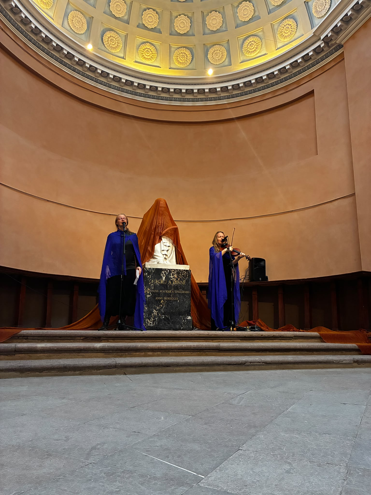
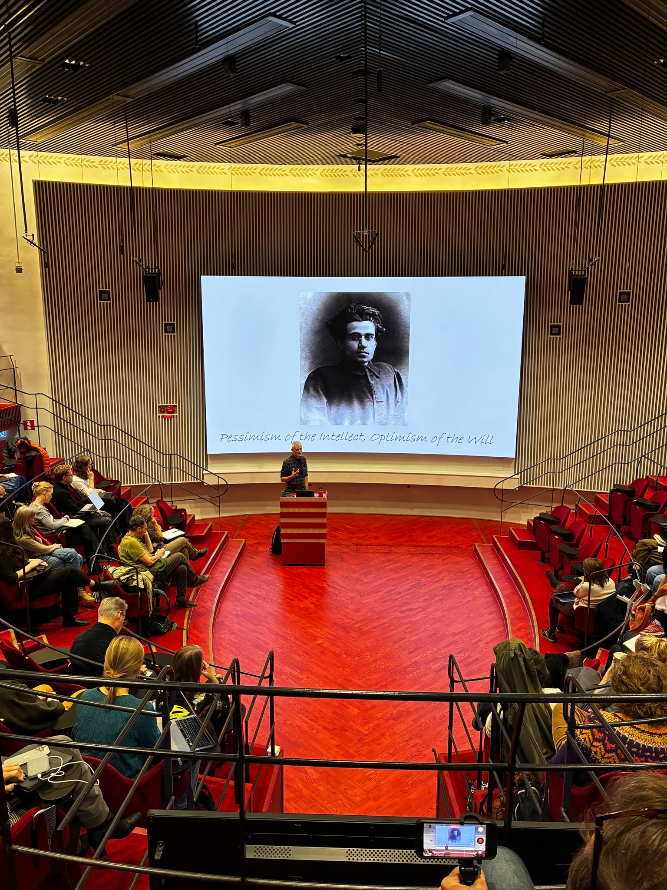
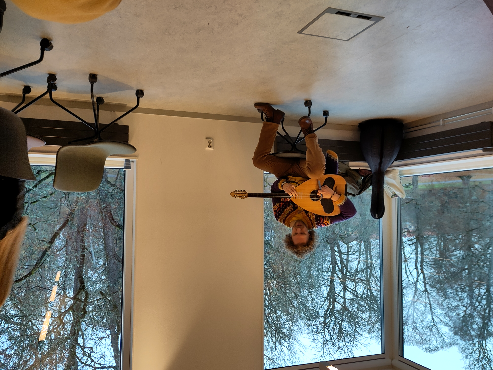
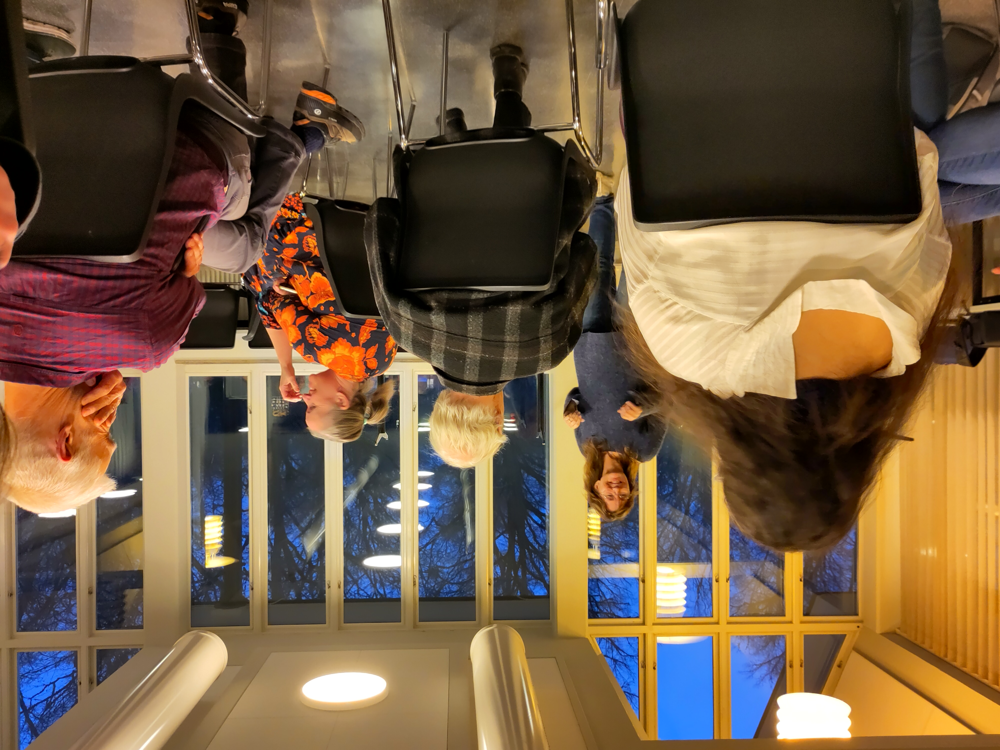

# ClimateExistence på CEMUS i Uppsala

Jag deltog just i en unik konferens. [ClimateExistence](https://www.cemus.uu.se/climateexistence/) samlar människor som ser och bryr sig om klimatkrisen, men tar sig an den på ett interdisciplinärt sätt. Forskare, konstnärer, aktivister, pedagoger. Och många andra. Jag känner en stor samhörighet i den här skaran - samhörighet i brokigheten, i viljan att gå till roten, i nyfikenheten, i vägran att bara passa in.

Det började med Kevin Anderson ([INSPELNING](https://youtu.be/URDW5bRjE9c)), klimatforskare. Data, känslor, interntionella avtal. Sedan gick vi till Orangeriet. Ida Lod och	 Julia Adzuki ledde oss genom en ritual för att utforska med våra kroppar. Vi ledde varandra i blindo och kände på giftiga växter.

En session jag var på handlare om frigörande pedagogik. I Paulo Freires anda fick vi testa på att lära oss och diskutera en frågeställning med hjälp av en pedagog från Brasilien. I en annan session om inre utveckling hade jag höga förväntningar, men kände mig inte bra med hur worshopledaren pratade. Min magkänsla växte, och till slut valde jag att bejaka på den och sade ifrån. Jag avbröt - och workshoppen transformerades till ett mycket mer dynamiskt delande mellan oss deltagare, i vilket även ledaren hade viss positiv inverkan. Jag blev mottagen på en ny väns soffa, vi pratade länge om digital suveränitet, och utbytte klistermärken.

Finlay Malcolm inledde andra dagen ([INSPELNING](https://youtu.be/QD8y211COAU)), han hade forskat på hur klimataktivism motiveras ut ett kristet perspektiv. Han jämförde "skapelsevårdare" med "skapelseprofeter". Jag fick under dagen höra många fascinerande livsöden. En cypriotisk luta. Jag fick vara med på en fascinerande diskussion om universiten, bör de räddas eller destitueras, med Isak Stoddard och [Lars Noväng](https://www.larsnovang.com/). Den avslutades ett strukturerat delande av berättelser, en så kallad "warm data lab" inspirerad av Nora Bateson.

ClimateExistence hölls på CEMUS som är ett interdisciplinärt forskningscenter på Uppsala Universitet. Det är en upplevelse att läsa deras kurskatalog. När jag gjorde det första gången för ett år sedan kände jag mig arg - arg att så många perspektiv hade saknats från min utbildning på KTH. 

På en interdisciplinär konferens fanns det bästa också i springorna mellan programnkterna. Skämten. Erfareneterna. Sorgen och hoppet.

